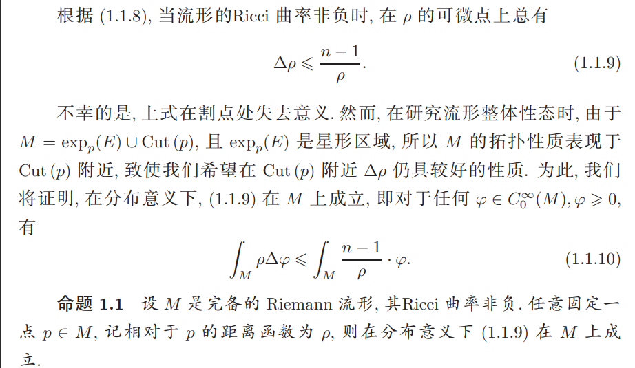

# 黎曼几何一则：距离函数的拉普拉斯

<time datetime="2025-02-08">2025 年 2 月 8 日</time>数学随想

本问题是我在上个学期的黎曼几何课上学到的，来自丘成桐《微分几何讲义》：

<figure class="hm-figure" markdown>

<figcaption>距离函数拉普拉斯比较不等式的分布意义表述。</figcaption>
</figure>

这个定理描述的是黎曼流形上距离函数的拉普拉斯的一个性质。首先，由 Laplace 比较定理可以得到：当流形的 Ricci 曲率非负时，在距离函数 $\rho$ 的可微点上总有

$$
\Delta \rho \leq \frac{n-1}{\rho}.
$$

然而，上式在割点处失去意义。

我们先来看看如下“证明”。记

$$
\Omega = \exp_p(E),
\qquad
M = \Omega \cup \operatorname{Cut}(p),
$$

其中 $\Omega$ 为星形区域：从 $p$ 点出发的每条测地线与 $\Omega$ 的边界只相交一次。因此可取一族星形子域

$$
\Omega_{\varepsilon}=\exp_p(E_{\varepsilon})\subset\Omega,
$$

其极限为 $\Omega$，且 $\Omega_{\varepsilon}$ 是 $\Omega$ 沿 $\rho$ 方向内缩形成的。

对任意非负的 $\varphi\in C_c^{\infty}(M)$，有

$$
\begin{aligned}
\int_M \rho\,\Delta\varphi
&= \int_\Omega \rho\,\Delta\varphi \\
&= \lim_{\varepsilon\to0^+}
   \int_{\exp_p(E_\varepsilon)} \rho\,\Delta\varphi.
\end{aligned}
$$

根据 Green 公式，

$$
\int_\Omega (f\Delta g-g\Delta f)
=\int_{\partial\Omega}
\left(f\frac{\partial g}{\partial\gamma}
-g\frac{\partial f}{\partial\gamma}\right)\,d\sigma,
$$

可以得到

$$
\begin{aligned}
\int_M \rho\,\Delta\varphi
=\lim_{\varepsilon\to0^+}\Bigg[
&\int_{\exp_p(E_\varepsilon)} \varphi\,\Delta\rho \\
&+\int_{\partial\exp_p(E_\varepsilon)}
\left(\rho\frac{\partial\varphi}{\partial\gamma}
-\varphi\frac{\partial\rho}{\partial\gamma}\right)d\sigma
\Bigg].
\end{aligned}
$$

由于 $\varphi\geq 0$ 且 $\partial\rho/\partial\gamma\geq0$，故上式不超过

$$
\begin{aligned}
\lim_{\varepsilon\to0^+}
\int_{\exp_p(E_\varepsilon)}
\varphi\frac{n-1}{\rho}\,dx
+\lim_{\varepsilon\to0^+}
\int_{\partial\exp_p(E_\varepsilon)}
\rho\frac{\partial\varphi}{\partial\gamma}\,d\sigma.
\end{aligned}
$$

到这里，我们会发现和待证结论相比多出一项：

$$
\lim_{\varepsilon\to0^+}
\int_{\partial\exp_p(E_\varepsilon)}
\rho\frac{\partial\varphi}{\partial\gamma}\,d\sigma.
$$

为什么呢？

事实上，需要采取书中的处理。利用 $\rho$ 是 Lipschitz 函数，它几乎处处可微，并适用 Lipschitz 函数的 Stokes 公式：

$$
\begin{aligned}
\int_M \rho\,\Delta\varphi
&=-\int_M \nabla\varphi\cdot\nabla\rho \\
&=-\lim_{\varepsilon\to0}
  \int_{\Omega_\varepsilon}
  \nabla\rho\cdot\nabla\varphi.
\end{aligned}
$$

再利用 Green 公式得到

$$
-\int_{\Omega_\varepsilon}
\nabla\rho\cdot\nabla\varphi
=\int_{\Omega_\varepsilon}
\varphi\,\Delta\rho
-\int_{\partial\Omega_\varepsilon}
\varphi\frac{\partial\rho}{\partial\nu}.
$$

这样就消去了前面“证明”中多出的那一项。

**总结：** 距离函数是 Lipschitz 函数；Lipschitz 函数几乎处处可微，并有相应的 Stokes 公式。有时候，是否精细地使用函数的性质，正是命题能否证出的关键。
